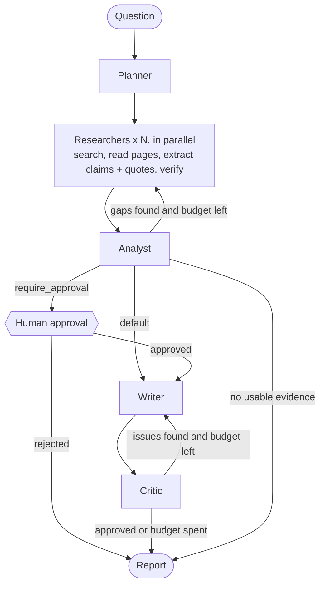

# Architecture

## Workflow



Both loops are bounded (`MARS_MAX_ROUNDS`, `MARS_MAX_REVISIONS`), and the whole run has a deadline
(`MARS_RUN_TIMEOUT`).

## Code layout

```
src/mars/
  core/       config, logging (run-id correlation), retry/backoff, TTL cache, text utils + quote check, usage counters, errors
  llm/        LLM protocol, LangChain wrapper (timeouts, retries, usage), offline MockLLM
  storage/    reports + vector index (Postgres/pgvector, SQLite), embedders (OpenAI, Google, fastembed, offline hash)
  tools/      search (Tavily/DDG + fallback + cache + cleaning), page fetcher (SSRF guard, robots, size caps)
  agents/     planner, researcher, analyst, writer, critic  (functions over Deps)
  workflow/   state, graph (LangGraph wiring), service (streaming, timeouts, persistence), deps, runtime (opens DB + checkpointer)
  api/        FastAPI app factory, research + report routes, auth + rate limiting, request/response models
  evaluation/ metrics and datasets
  cli.py      mars ask | serve | eval | doctor | reports | memory
  schemas.py  Pydantic models passed between agents
  prompts.py  prompts and input formatters
```

Dependency direction: `api/cli -> workflow -> agents -> tools/llm/storage -> core`. `agents` receive a
`Deps` bundle and never construct clients themselves, which is why every agent is unit-testable with fakes.
`workflow/runtime.py` is the only place that opens long-lived resources (database pools, checkpointer).

API reference: [api.md](api.md).

## Evidence pipeline (why reports can be trusted more than raw LLM output)

1. **Search** returns URLs; results are canonicalised (tracking params stripped), deduplicated and
   filtered against a domain blocklist.
2. **Fetch** reads the top-k pages (public http(s) only, redirects re-validated, 1.5 MB cap,
   robots.txt honoured) and extracts the article text.
3. **Extract**: the researcher must return, per claim, the URL(s) and a verbatim *quote*.
   `quote_supported` checks the quote against that page's text; failing claims are dropped and counted.
4. **Register**: the analyst code assigns citation ids to URLs. The LLM can only cite those ids;
   invented ids are stripped.
5. **Write + critique**: the report cites `[n]`; deterministic checks reject missing/invalid
   citations and uncited paragraphs; the reference list is generated from the registry.
6. **Warn**: the report carries `warnings` (failed tasks, dropped claims, single-domain evidence,
   critic not satisfied) so consumers can decide how far to trust it.

Web text is fenced in `<source>` tags, stripped of control characters, and the prompts tell the
model it is untrusted. A prompt injection can at most make a researcher emit a claim, and that claim
still has to be backed by a quote that exists in the page.

## Storage and memory

| Data | Postgres (`MARS_DATABASE_URL`) | SQLite (`MARS_STORAGE_DB`) |
|---|---|---|
| Completed reports | table `mars_reports` (jsonb) | table `reports` |
| Verified quotes + embeddings | table `mars_chunks`, pgvector HNSW cosine index | table `chunks`, exact brute-force cosine |
| Paused/in-flight runs | LangGraph checkpoint tables | separate file via `MARS_CHECKPOINT_DB` |

- Only `complete` reports are saved, and only quotes that passed verification are indexed.
- The embedding model and dimension are recorded in the database (`mars_meta` / `meta`). Starting
  with a different embedder is refused instead of mixing incompatible vectors.
- Saving is best effort: a storage failure is logged and the run result is still returned
  (`stored: false` in the `report` event).
- With `MARS_USE_MEMORY=true`, each researcher also searches this index and adds matching quotes as
  extra evidence labelled "earlier research, indexed <date>". They are ranked after fresh web results
  and must pass the same quote check.

## Internal documents

With `MARS_DOCS_DB` set, uploaded files are read, chunked, embedded and stored in their own SQLite
index (`documents`, `doc_chunks`; exact cosine search, embedding model recorded like the report store).

- **Readers** (`mars/docs/extract.py`): PDF (text layer; scanned pages via vision/OCR), Word, PowerPoint
  (slides, notes, pictures), Excel (rows tagged with column headers), images (vision LLM, OCR fallback), text.
- **Retrieval**: each researcher searches the index with its task query. Passages are grouped into one
  source per document (`doc://<id>/<name>`, labelled with page/slide/sheet) and placed *before* web
  results so they win the evidence budget. If web search fails but documents matched, the task still runs.
- **Trust**: document text is fenced in `<source>` tags like web text, and claims must pass the same quote
  check. `doc://` quotes are never copied into report memory, so deleting a document leaves no residue.
- **Device**: local embedding models (`MARS_EMBEDDING_PROVIDER=local`) run on CUDA, Apple MPS or CPU
  (`MARS_DEVICE`). LLM calls are API calls and do not use the local GPU.
- `MARS_WEB_SEARCH=false` makes research documents-only.
- **Auto-sync** (`mars/docs/sync.py`, `MARS_DOCS_DIR`): a background task compares the folder with the index by
  path, mtime, size and content hash. Deletions run first (so a rename frees its hash), then new files are
  added and changed files are indexed anew before the stale version is dropped. One scan runs at a time;
  failures are recorded per file and never stop the loop. Older indexes gain the `source`/`mtime` columns on startup.

## Known limits

- Quote verification proves a claim was *stated by the source*, not that the source is correct.
- Web pages that need JavaScript, paywalls and web-hosted PDFs are not read (snippet only); uploaded PDFs are. Verification is then
  weaker because snippets are short.
- DuckDuckGo search is scraped and throttles bursts; MARS spaces its calls, but Tavily is the dependable option.
- SSRF check resolves DNS before connecting; a hostile DNS server could rebind in between.
- Rate limiting and run accounting are per process; use a gateway/Redis for multi-worker deployments.
- Vector search quality depends on the embedder; the offline hash embedder is lexical only.
- Stored reports are shared across API keys (no tenant isolation) and never expire automatically.
